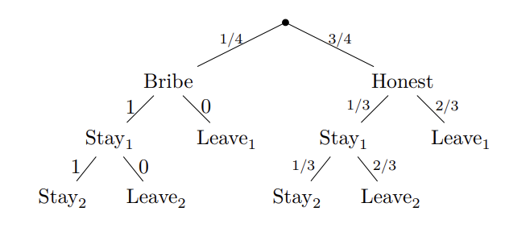

Sędziowie prowadzący popularny program telewizyjny *Taniec ze Statystykami*, wykorzystują swoją władzę i przyjmują łapówki od uczestników. W każdym odcinku dany uczestnik może albo zostać w programie, albo zostać wyrzucony.

-   Jeśli uczestnik daje łapówki, na pewno zostanie w programie.

-   Jeśli uczestnik nie daje łapówek, zostanie wyrzucony z programu w $\frac{2}{3}$ przypadków.

Załóżmy, że 25% uczestników oszukuje. Ci sami uczestnicy dają łapówki w obu rundach, tj. jeśli uczestnik daje łapówki w pierwszej rundzie, robi to również w drugiej (i vice versa).

a)  Jeśli wybierzesz losowego uczestnika, który został w programie podczas pierwszego odcinka, jakie jest prawdopodobieństwo, że dawał łapówki sędziom?

b)  Jeśli wybierzesz losowego uczestnika, jakie jest prawdopodobieństwo, że zostanie w programie podczas obu pierwszych odcinków?

c)  Jeśli wybierzesz losowego uczestnika, który został w programie podczas pierwszego odcinka, jakie jest prawdopodobieństwo, że zostanie wyrzucony w drugim odcinku?

## Rozwiązanie

Wizualizujemy sytuację przy pomocy drzewka:

Wprowadzamy następujące oznaczenia:

-   $B$: uczestnik przekupuje sędziów,

-   $H$: uczestnik jest uczciwy (nie przekupuje sędziów),

-   $S_1$: uczestnik został w pierwszym odcinku,

-   $S_2$: uczestnik został w drugim odcinku,

-   $L_1$: uczestnik został wyrzucony w pierwszym odcinku,

-   $L_2$: uczestnik został wyrzucony w drugim odcinku.

### a)

Najpierw obliczamy $P(S_1)$ korzystając z tw. o prawdopodobieństwie całkowitym:
$$P(S_1) = P(S_1|B)P(B) + P(S_1|H)P(H)$$
$$P(S_1) = 1 \cdot \frac{1}{4} + \frac{1}{3} \cdot \frac{3}{4} = \frac{1}{4} + \frac{1}{4} = \frac{1}{2}.$$
Następnie obliczamy $P(B|S_1)$ z twierdzenia Bayesa:
$$P(B|S_1) = \frac{P(S_1|B)P(B)}{P(S_1)} = \frac{1 \cdot \frac{1}{4}}{\frac{1}{2}} = \frac{1}{2}.$$

### b)

Korzystając z drzewka, możemy obliczyć prawdopodobieństwo $S_2$:
$$P(S_2) = P(S_2 | S1, B) P(S1 | B) P(B) + P(S_2 | S1, H) P(S1 | H) P(H) = 1 \cdot 1 \cdot \frac{1}{4} + \frac{1}{3} \cdot \frac{1}{3} \cdot \frac{3}{4} = \frac{1}{3}.$$

### c)

Chcemy obliczyć $P(L_2 | S_1)$:
$$P(L_2 | S_1) = \frac{P(L_2 \cap S_1)}{P(S_1)}.$$
Z poprzednich obliczeń mamy $P(S_1) = \frac{1}{2}$. Dla licznika, korzystając z drzewka:
$$P(L_2 \cap S_1) = P(L_2 \cap S_1 | B)P(B) + P(L_2 \cap S_1 | H)P(H).$$
$$P(L_2 \cap S_1) = 0 \cdot 1 \cdot \frac{1}{4} + \frac{2}{3} \cdot \frac{1}{3} \cdot \frac{3}{4} = \frac{1}{6}.$$
Zatem:
$$P(L_2 | S_1) = \frac{\frac{1}{6}}{\frac{1}{2}} = \frac{1}{3}.$$
