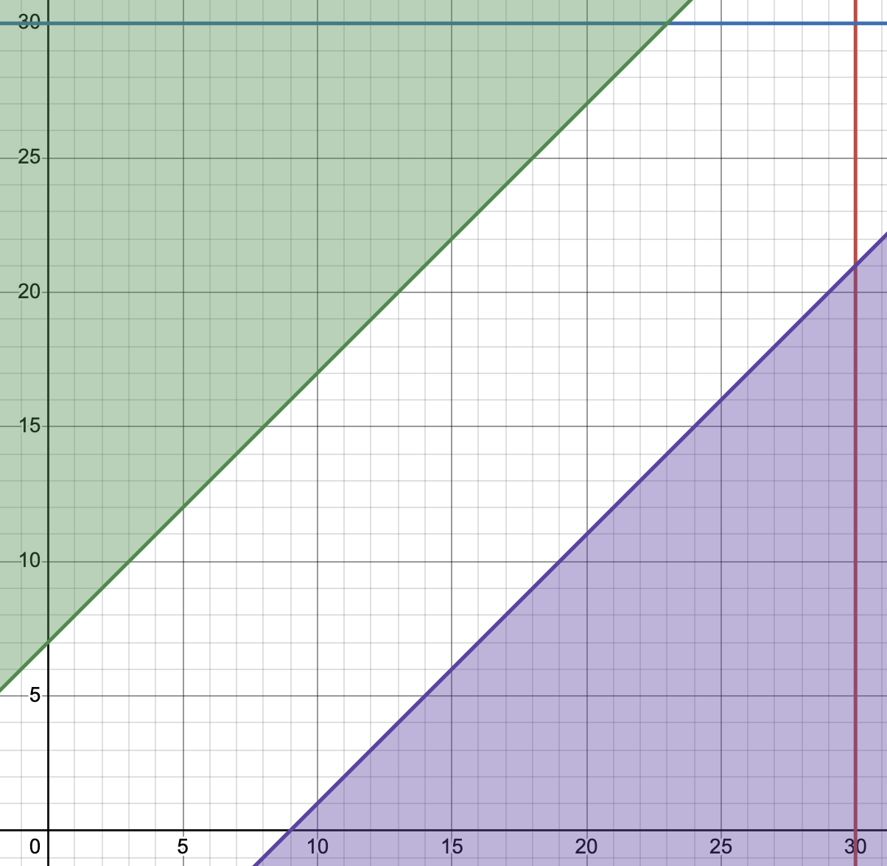

Na dwóch lotniskach w ciągu 30 minut mają wylądować niezależnie
dwie pary samolotów. W każdej parze jest maszyna typu A i maszyna typu B.
Samolot typu A zajmuje w czasie lądowania pas na 7 minut, a samolot typu B
na 9 minut. Jakie jest prawdopodobieństwo tego, że na przynajmniej jednym
z lotnisk samoloty nie będą na siebie czekać?

## Rozwiązanie

Oba lotniska są takie same, lądowanie samolotów jest niezależne w związku z tym skupiamy się na jednym lotnisku. Niech $t_A$ i $t_B$ będą czasami rozpoczęcia lądowania odpowiednio dla samolotów A i B, równomiernie rozłożonymi na $[0, 30]$. W związku z tym:
$$\Omega = \{(t_A, t_B): (t_A, t_B) \in [0, 30]^2 \}$$
Od razu zauważamy, że:
$$|\Omega| = 30 \cdot 30 = 900.$$
Brak czekania samolotów występuje, gdy:
$$t_A \leq t_B \land t_A + 7 \leq t_B \quad \text{lub} \quad t_B \leq t_A \land t_B + 9 \leq t_A.$$
Przy pomocy $A$ oznaczamy zdarzenie lądowania pary samolotów bez czekania.
$$A = \{(t_A, t_B) \in \Omega, t_A + 7 \leq t_B \land t_B + 9 \leq t_A \}$$
$\Omega$ to kwadrat $[0,30]^2$, $A$ to część kwadratu wyznaczana przez proste $t_A + 7 \leq t_B$ i $t_B + 9 \leq t_A$.

Możemy zauważyć, że $A$ składa się z dwóch trójkątów prostokątnych, równoramiennych. Zielony trójkąt ma przyprostokątne długości $30 - 7 = 23$, fioletowy ma przyprostokątne długości $30 - 9 = 21$. W związku z tym:
$$|A| = |\Delta_{Z}| + |\Delta_{F}| = \frac{23^2}{2} + \frac{21^2}{2} = \frac{529}{2} + \frac{441}{2} = \frac{970}{2} = 485.$$
Obliczamy $P(A)$:
$$P(A) = \frac{|A|}{|\Omega|} = \frac{485}{900} = \frac{97}{180}$$
Wiemy, że są dwa lotniska. Niech $B$ oznacza, że przynajmniej na jednym
z lotnisk samoloty nie będą na siebie czekać. Zdarzenie przeciwne do $B$ to sytuacja, w której samoloty czekają na siebie na obu lotniskach:
$$P(B') = 1 - P(B) = P(A_1', A_2')$$
Korzystamy z tego, że lotniska są takie same:
$$P(A_1) = P(A_2) = P(A) \implies P(A_1') = P(A_2') = 1 - P(A)$$
i z niezależności lądowań:
$$P(B') = 1 - P(B) = P(A_1', A_2') = P(A_1') P(A_2') = (1-P(A))^2$$
Wynika z tego, że:
$$P(B) = 1 - (1 - P(A))^2 = 1 - \bigl(1 - \frac{97}{180}\big)^2 = 1 - \bigl(\frac{83}{180}\big)^2$$
