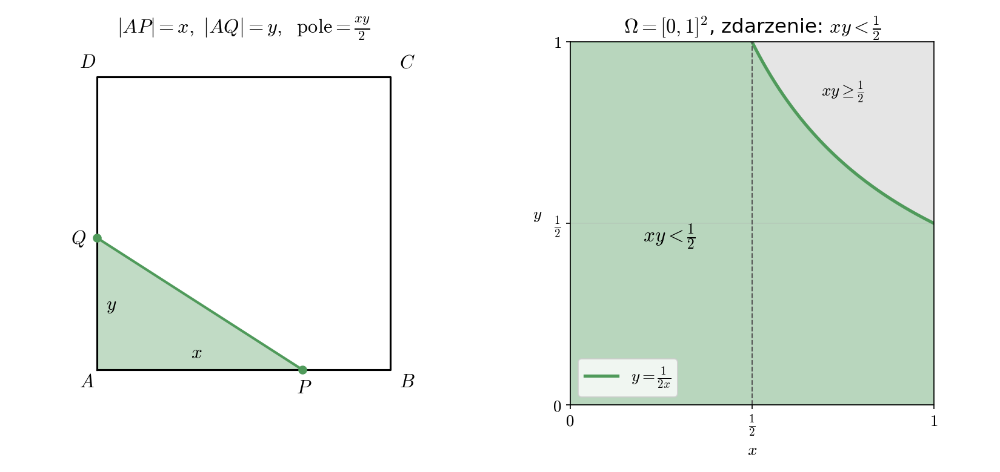

Dany jest kwadrat $ABCD$ o boku długości $1$.
Na boku $AB$ losujemy punkt $P$, a niezależnie na boku $AD$
losujemy punkt $Q$. Oba punkty wybieramy zgodnie z rozkładem
jednostajnym. Oblicz prawdopodobieństwo, że pole trójkąta $APQ$ jest mniejsze
niż $\frac{1}{4}$.

## Wskazówka

Położenie punktów opisz dwiema liczbami $x = |AP|$ i $y = |AQ|$. Punkt $(x, y)$ jest wtedy losowany
jednostajnie z kwadratu jednostkowego, więc szukane prawdopodobieństwo to pole odpowiedniego obszaru.

## Rozwiązanie

### Przestrzeń zdarzeń elementarnych

Niech $x = |AP|$ i $y = |AQ|$. Punkty $P$ i $Q$ losujemy niezależnie i jednostajnie, więc para $(x, y)$
ma rozkład jednostajny na kwadracie
$$\Omega = \{(x, y) : 0 \leq x \leq 1,\ 0 \leq y \leq 1\} = [0,1]^2, \qquad |\Omega| = 1.$$
Korzystamy z prawdopodobieństwa geometrycznego: $P(Z) = \frac{|Z|}{|\Omega|} = |Z|$.

### Zdarzenie

Kąt $DAB$ jest prosty, więc trójkąt $APQ$ jest prostokątny z przyprostokątnymi $x$ i $y$:
$$\text{pole}(APQ) = \frac{xy}{2}.$$
Szukamy prawdopodobieństwa zdarzenia
$$Z = \left\{(x, y) \in \Omega : \frac{xy}{2} < \frac{1}{4}\right\} = \left\{(x, y) \in \Omega : xy < \frac{1}{2}\right\}.$$

Zdarzenie $Z$ od jego dopełnienia oddziela w kwadracie łuk hiperboli $y = \frac{1}{2x}$ dla $x \in [\frac{1}{2}, 1]$. Dla $x \leq \frac{1}{2}$ mamy $xy \leq \frac{1}{2} \cdot 1 = \frac{1}{2}$,
czyli nierówność $xy < \frac{1}{2}$ zachodzi dla każdego $y \in [0,1]$ (z wyjątkiem jednego punktu $(\frac{1}{2}, 1)$, który ma pole $0$).
Dla $x > \frac{1}{2}$ warunek oznacza $y < \frac{1}{2x}$, przy czym $\frac{1}{2x} < 1$.

### Pole obszaru

Dzielimy całkę na dwa przedziały:
$$|Z| = \int_0^{1/2} 1 \, dx + \int_{1/2}^1 \frac{1}{2x} \, dx = \frac{1}{2} + \frac{1}{2}\Big[\ln x\Big]_{1/2}^1 = \frac{1}{2} + \frac{1}{2}\left(0 - \ln\frac{1}{2}\right) = \frac{1}{2} + \frac{\ln 2}{2}.$$

Można też policzyć pole zdarzenia przeciwnego (szary obszar nad hiperbolą):
$$|Z'| = \int_{1/2}^1 \left(1 - \frac{1}{2x}\right) dx = \frac{1}{2} - \frac{\ln 2}{2}, \qquad |Z| = 1 - |Z'|.$$

### Odpowiedź

$$P\left(\text{pole}(APQ) < \frac{1}{4}\right) = \frac{1 + \ln 2}{2} \approx 0{,}847.$$
