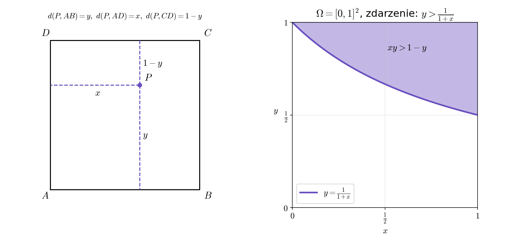

Dany jest kwadrat $ABCD$ o boku długości $1$.
W jego wnętrzu losujemy punkt $P$ zgodnie z rozkładem
jednostajnym. Oblicz prawdopodobieństwo, że iloczyn odległości punktu $P$
od boków $AB$ i $AD$ jest większy niż jego odległość
od boku $CD$.

## Wskazówka

Wprowadź układ współrzędnych z początkiem w $A$ i zapisz odległości od boków jako funkcje współrzędnych punktu $P = (x, y)$.

## Rozwiązanie

### Przestrzeń zdarzeń elementarnych

Umieszczamy kwadrat w układzie współrzędnych: $A = (0, 0)$, $B = (1, 0)$, $C = (1, 1)$, $D = (0, 1)$.
Punkt $P = (x, y)$ ma rozkład jednostajny na
$$\Omega = [0,1]^2, \qquad |\Omega| = 1,$$
więc (prawdopodobieństwo geometryczne) $P(Z) = \frac{|Z|}{|\Omega|} = |Z|$. To, czy brzeg kwadratu należy do $\Omega$, nie ma znaczenia, bo ma on pole $0$.

### Zdarzenie

Bok $AB$ leży na prostej $y = 0$, bok $AD$ na prostej $x = 0$, a bok $CD$ na prostej $y = 1$. Zatem
$$d(P, AB) = y, \qquad d(P, AD) = x, \qquad d(P, CD) = 1 - y.$$
Szukamy prawdopodobieństwa zdarzenia
$$Z = \{(x, y) \in \Omega : xy > 1 - y\}.$$
Przekształcamy nierówność (dzielimy przez $1 + x > 0$):
$$xy > 1 - y \iff y(1 + x) > 1 \iff y > \frac{1}{1 + x}.$$

Dla $x \in [0, 1]$ mamy $\frac{1}{1+x} \in [\frac{1}{2}, 1]$, więc ten fragment wykresu $y = \frac{1}{1+x}$ leży w kwadracie,
a zdarzenie $Z$ to obszar nad nią.

### Pole obszaru

$$|Z| = \int_0^1 \left(1 - \frac{1}{1 + x}\right) dx = \Big[x - \ln(1 + x)\Big]_0^1 = 1 - \ln 2.$$

### Odpowiedź

$$P\big(d(P, AB) \cdot d(P, AD) > d(P, CD)\big) = 1 - \ln 2 \approx 0{,}307.$$
